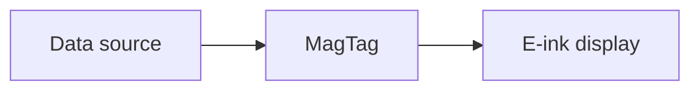

# Personal site

A minimal [Zola](https://www.getzola.org/) site for a GitHub user page.

## Local development

Install Zola, then run `zola serve` and open the address it prints. Run `zola build` to generate the site in `public/`.

## Add a topic

Add a Markdown file in `content/topics/` with a title, a short first-person motivation, and an image path relative to `static/`:

```toml
+++
title = "My topic"
date = 2026-11-26

[extra]
image = "images/my-topic.png"
motivation = "I wanted a simpler way to solve a problem I kept running into."
+++

Content for the topic page.
```

Set the top-level `date` to the project creation date. The homepage lists projects newest first. Leave the date alone when editing a project. For projects created on the same day, include the time if their order matters (for example, `2026-11-26T14:30:00Z`).

Put the image in `static/images/`. To link straight to a repository instead of the topic page, add `external_url = "https://github.com/username/repository"` under `[extra]`. The two example topics can be edited or removed.

## Diagrams

Use a fenced `mermaid` code block in a topic page to render a diagram:

````markdown

````

The browser loads Mermaid from jsDelivr only on pages with diagrams. JavaScript and access to the CDN are required to render them; otherwise, the diagram source remains visible. See the [Mermaid documentation](https://mermaid.js.org/intro/) for diagram types and syntax.

## Personal links

Edit the `links` list in `config.toml` to add or change the links on the home page. LinkedIn and Mastodon examples are included as comments.

## Publishing

The site URL is `https://greg76.github.io/`. Pushes to `main` build and publish the site with GitHub Actions. In the repository's Pages settings, the build and deployment source must be set to GitHub Actions.

Existing project sites use paths including `/toth` and `/dervarics.hu`. Keep those paths available for their respective projects. Topic pages currently live under `/topics/`; use `external_url` to link to an existing project site or repository.
