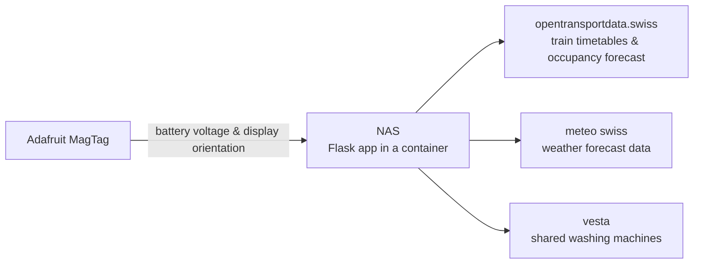

+++
title = "E-ink family dashboard"
date = 2026-10-10

[extra]
image = "images/magtag.jpg"
motivation = "Do I need a raincoat? Which train can we catch? Is a washing machine available downstairs?"
+++

I'd had an [Adafruit MagTag](https://learn.adafruit.com/adafruit-magtag) lying around for a long time. When the family kept asking what to wear for the weather, which train to catch to Lausanne, and whether a washing machine was available in our apartment building, I knew I had a little project on my hands.

## Technical design

Troubleshooting and deploying to embedded hardware always add some friction. I knew I'd want to iterate quickly and try different layouts to make the data legible on a small, 2.9-inch screen. So I kept the client application simple: it just asks the backend for a new image. All API requests, parsing, data transformation, and rendering happen on my trusty NAS.

Since the MagTag's e-ink display doesn't support partial refreshes in CircuitPython, even the battery icon has to be rendered on the backend. The client sends its battery voltage, screen orientation, and screen/function ID with each request. The backend converts the voltage in millivolts to a percentage and renders the battery icon as part of the image.

The MagTag has four physical buttons, so I assigned a different function to each. Two provide weather forecasts:

* Overview for the day, showing current, minimum and maximum temperatures, overall weather.
* Hourly forecast for the next six hours, to help decide when to take a rain jacket.

The e-ink display only consumes power when it refreshes, but keeping the ESP32 idle still used a noticeable amount of power. To get several days of battery life from the small, 420 mAh battery, I put the microcontroller into deep sleep. It wakes up every ten minutes to fetch an update, or whenever a physical button is pressed. This makes the device slower to respond, but significantly increases the time between charges.
