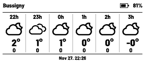
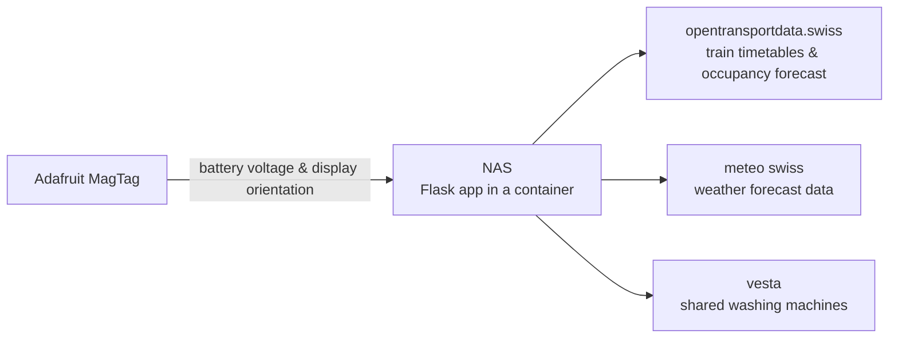

+++
title = "E-ink family dashboard"
date = 2026-10-10

[extra]
image = "topics/magtag/magtag.jpg"
motivation = "Do I need a raincoat? Which train can we catch? Is a washing machine available downstairs?"
+++

I'd had an [Adafruit MagTag](https://learn.adafruit.com/adafruit-magtag) lying around for a long time. When the family kept asking what to wear for the weather, which train to catch to Lausanne, and whether a washing machine was available in our apartment building, I knew I had a little project on my hands.

## What I have learned

The first version of the train screen showed the expected departure time beside the delay (as per the API response). Reading 08:32 +5′, I could easily add the five minutes twice and get us out the door late. I switched to showing the scheduled time alongside the delay. Now 08:27 +5′ tells me the 08:27 train is expected at 08:32. I also kept cancelled trains visible. If our usual train is cancelled, that’s the first thing I want to know.

One thing my family already checked in the SBB app was how crowded a train was likely to be. When two trains are ten minutes apart, we might wait for the quieter one. The first timetable service I tried returned no occupancy forecasts for Bussigny. I switched after checking that another service could tell us how crowded second class was likely to be when we boarded.

For the weather screen, I tried a few layouts. Six hours fit comfortably on the display. Beyond that, the temperature and rainfall figures became hard to read. I kept that window the same size throughout the day. If the forecast stopped at midnight, we'd have six hours to scan in the afternoon and only one late in the evening. At 22:00, the screen carries on into tomorrow. With the same six hours laid out each time, we know where to look for rain coming later and how far ahead we're looking.

<figure class="magtag-weather">
  
    
  
  <figcaption>Bussigny hourly weather · 22:00–03:00</figcaption>
</figure>

I started with a generic formula for estimating battery percentage from voltage. After a few days, I noticed the percentage dropped sharply and then spent a long time near the bottom. I plotted the voltage readings the MagTag had logged and used its discharge curve to refine the estimate.

## Technical design

Troubleshooting and deploying to embedded hardware always add some friction. I knew I'd want to iterate quickly and try different layouts to make the data legible on a small, 2.9-inch screen. So I kept the client application simple: it just asks the backend for a new image. All API requests, parsing, data transformation, and rendering happen on my trusty NAS.

The NAS also serves a web page with the same dashboard views, so we can check the weather or the trains from a phone or laptop. On the weather view, I can expand the details to see when MeteoSwiss issued the forecast and compare its rainfall figures with the summary on the screen. If the display says “rain in three days”, I can check the daily totals and see how it reached that conclusion.

Since the MagTag's e-ink display doesn't support partial refreshes in CircuitPython, even the battery icon has to be rendered on the backend. The client sends its battery voltage, screen orientation, and screen/function ID with each request. The backend converts the voltage in millivolts to a percentage and renders the battery icon as part of the image.

The MagTag has four physical buttons, so I assigned a different function to each. Two provide weather forecasts:

* Overview for the day, showing current, minimum and maximum temperatures, overall weather.
* Hourly forecast for the next six hours, to help decide when to take a rain jacket.

The e-ink display only consumes power when it refreshes, but keeping the ESP32 idle still used a noticeable amount of power. To get several days of battery life from the small, 420 mAh battery, I put the microcontroller into deep sleep. It wakes up every ten minutes to fetch an update, or whenever a physical button is pressed. This makes the device slower to respond, but significantly increases the time between charges.
